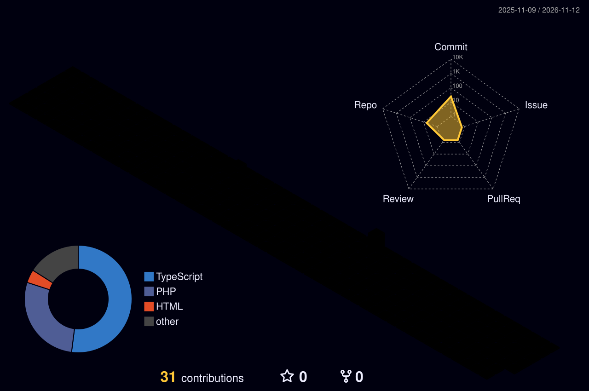

<p align="center">
  <a href="https://mahekgiri.com">

<p align="center">
  <a href="https://mahekgiri.com">
    
  </a>
</p>

<p align="center">
  <a href="https://mahekgiri.com"></a>
  <a href="https://www.linkedin.com/in/mahekgiri-gosai-84352a214"></a>
  <a href="mailto:mahek@mahekgiri.com"></a>
  
</p>

---

## 🧑‍💻 About Me

```php
<?php
$developer = [
    'name'       => 'Mahekgiri Gosai',
    'role'       => 'Senior WordPress Developer @ Teqto Infotech',
    'experience' => '5+ years',
    'location'   => 'Rajkot, Gujarat, India',
    'focus'      => ['Custom Themes', 'Custom Plugins', 'WooCommerce', 'Headless WP'],
    'seo'        => ['Core Web Vitals', 'Schema / JSON-LD', 'AEO / GEO'],
    'available'  => true, // open to freelance worldwide
];
```

---

## 🧰 Tech Stack

<p align="center">
  
</p>

<p align="center">
  
  
  
  
  
  
  
  
  
  
</p>

---

## 📊 GitHub Activity

<p align="center">
  
</p>

<picture>
  <source media="(prefers-color-scheme: dark)" srcset="profile-3d-contrib/github-snake-dark.svg"/>
  <source media="(prefers-color-scheme: light)" srcset="profile-3d-contrib/github-snake.svg"/>
  
</picture>

---

## 🤝 Let's Work Together

I help agencies and businesses ship **fast, SEO-ready WordPress sites** — from Figma to production.

<p align="center">
  <a href="https://mahekgiri.com"><b>🌐 mahekgiri.com</b></a> &nbsp;•&nbsp;
  <a href="mailto:mahek@mahekgiri.com"><b>📩 mahek@mahekgiri.com</b></a>
</p>


